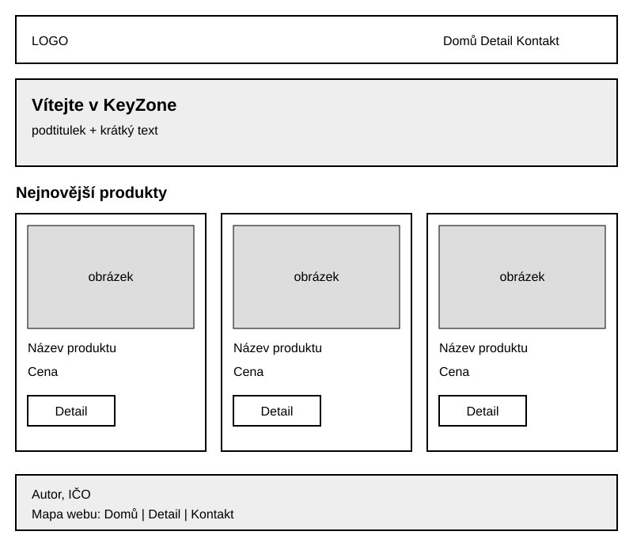

# KeyZone – Milníkový projekt (statický e-shop)

Jednoduchý statický e-shop s herními myšmi a klávesnicemi. Jen HTML5 a CSS, bez JavaScriptu, bez frameworků a bez backendu.

**Autor:** Thai Duong

## 1. Odkaz na GitHub

[DOPLNÍM SÁM]

## 2. Živá verze na školním serveru

[DOPLNÍM SÁM]

## 3. Checklist požadavků

### Soubory

- [x] `index.html`, `detail.html`, `kontakt.html`, `css/style.css`, `img/`, `README.md`
- [x] Skript na obrázky: `tools/obrazky.py`

### Na každé stránce (index.html / detail.html / kontakt.html)

- [x] `<html lang="cs">`: řádek 2 ve všech třech souborech
- [x] Odkaz na `css/style.css`: řádek 8 ve všech třech souborech
- [x] `<header>` s logem (SVG): řádky 11–21 ve všech třech souborech, logo na řádku 12
- [x] `<nav>` s odkazy na všechny 3 stránky a zpět na portfolio (`../index.html`, řádek 18): řádky 13–20 ve všech třech souborech
- [x] Aktuální stránka v menu má `aria-current="page"`: index.html řádek 15, detail.html řádek 16, kontakt.html řádek 17 (zvýraznění v CSS na řádcích 46–52)
- [x] `<main>`: index.html 23–69, detail.html 23–150, kontakt.html 23–52
- [x] `<footer>` se jménem, IČO a mapou webu: index.html 71–80, detail.html 152–161, kontakt.html 54–63

### index.html

- [x] Úvod s `<hgroup>` (nadpis + podtitulek): řádky 25–28
- [x] 3 produkty vedle sebe jako `<article>`: řádky 35–44, 46–55, 57–66
- [x] `loading="lazy"` u 2. a 3. obrázku produktu: řádky 50 a 61 (první obrázek bez něj)
- [x] Každý produkt má obrázek, název, cenu a tlačítko
- [x] Jen první produkt odkazuje na `detail.html`: řádek 43; ostatní mají `href="#"`: řádky 54 a 65
- [x] `<time datetime="...">` (datum přidání): řádky 42, 53, 64
- [x] `<mark>`: řádek 29
- [x] `<abbr>`: řádek 72

### detail.html

- [x] `<hgroup>`: řádky 26–29
- [x] `<time datetime="...">`: řádek 30
- [x] `<article>` s popisem produktu: řádky 25–130
- [x] Popis rozdělený do `<section>`: Popis 32–45, Vlastnosti 47–60, Použití 62–68, Pro koho je myš vhodná 70–79, Doručení 81–86 (navíc Galerie 88–120 a Video 122–128)
- [x] `<aside>` s parametry v seznamu `<dl>`: aside 132–148, dl 134–147
- [x] 5 obrázků v `<figure>` + `<figcaption>`, každý se `srcset` (400w, 800w, 1200w), `sizes`, `alt`, `width` a `height`: řádky 34–40, 91–97, 98–104, 105–111, 112–118
- [x] `loading="lazy"` u 4 obrázků v galerii (řádky 95, 102, 109, 116) a u `<iframe>` (řádek 126); hlavní obrázek bez něj
- [x] `<iframe>` s YouTube videem přes youtube-nocookie.com s atributem `title`: řádky 124–127 (**VIDEO_ID na řádku 124 doplním sám**)
- [x] `<abbr>`: řádky 51 a 153
- [x] `<mark>`: řádky 53 a 83
- [x] Zdroj textu („Text vygenerován pomocí AI“): řádek 129

### kontakt.html

- [x] `<hgroup>`: řádky 24–27
- [x] Info o firmě: řádky 29–34
- [x] `<address>` s kontakty: řádky 38–44, `mailto:` na řádku 42, `tel:` na řádku 43
- [x] `<iframe>` s mapou z OpenStreetMap: řádky 49–50
- [x] `<time datetime="...">`: řádek 32
- [x] `<mark>`: řádek 33
- [x] `<abbr>`: řádek 55

### Povinná sémantika (souhrn)

- [x] `<header>`, `<nav>`, `<main>`, `<section>`, `<article>`, `<aside>`, `<footer>`
- [x] `<time datetime="...">` a `<hgroup>`
- [x] `<address>`, `<abbr>`, `<mark>`
- [x] Validace na validator.w3.org: všechny 3 stránky 0 chyb a 0 varování; CSS na jigsaw.w3.org: 0 chyb

### Vzhled (css/style.css, 193 řádků)

- [x] Jen modrá a bílá: tmavě modrá `#15438c`, světle modrá `#dce9fa`, bílá `#ffffff`
- [x] Flat design: žádné stíny ani přechody, zaoblení max. 8 px
- [x] Písmo Arial / sans-serif: řádek 4
- [x] Produkty vedle sebe pomocí flexboxu: řádky 72–90

### Obrázky

- [x] SVG logo: `img/logo.svg`
- [x] Rastrové obrázky jen ve formátu WEBP, v projektu není žádný JPG ani PNG
- [x] Obrázky na detailu ve 3 velikostech (400w, 800w, 1200w)
- [x] Placeholder obrázek (`img/baleni-*.webp`) vygenerovaný skriptem `tools/obrazky.py`

### Jak spustit skript na obrázky

1. Nainstaluj knihovnu Pillow: `pip install pillow`
2. Původní JPG fotky musí ležet ve složce `../originaly-jpg/` (vedle složky projektu).
3. Z kořenové složky projektu spusť: `python tools/obrazky.py`
4. Hotové WEBP obrázky se uloží do složky `img/`.

## 4. Wireframe domovské stránky

## 5. Použití AI

### Nástroje

Claude (chat) a Claude Code.

### Co vygenerovala AI

- HTML struktura index.html, detail.html, kontakt.html
- css/style.css
- tools/obrazky.py a wireframe
- Texty na stránkách

### Co jsem udělal já

- [DOPLŇ jen to, co je pravda]

### Vysvětlení kódu a zdůvodnění

(Pro každou použitou část 1–2 věty vlastními slovy: co dělá a proč.
Např. proč `<hgroup>`, `<aside>`, `srcset`, `<time>`, WEBP.)
